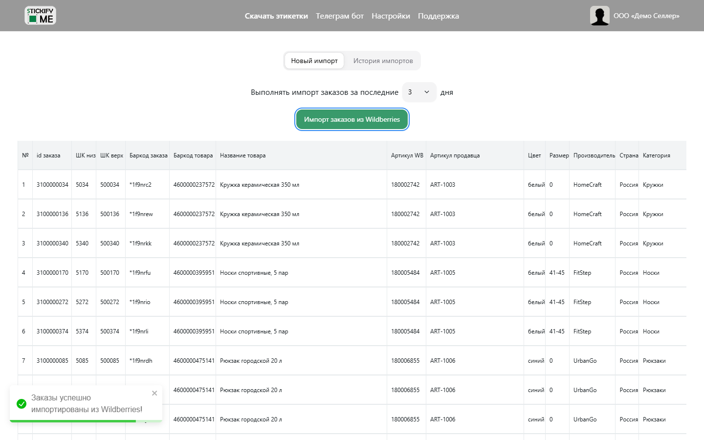
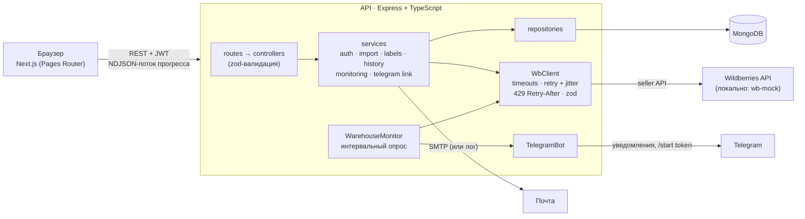
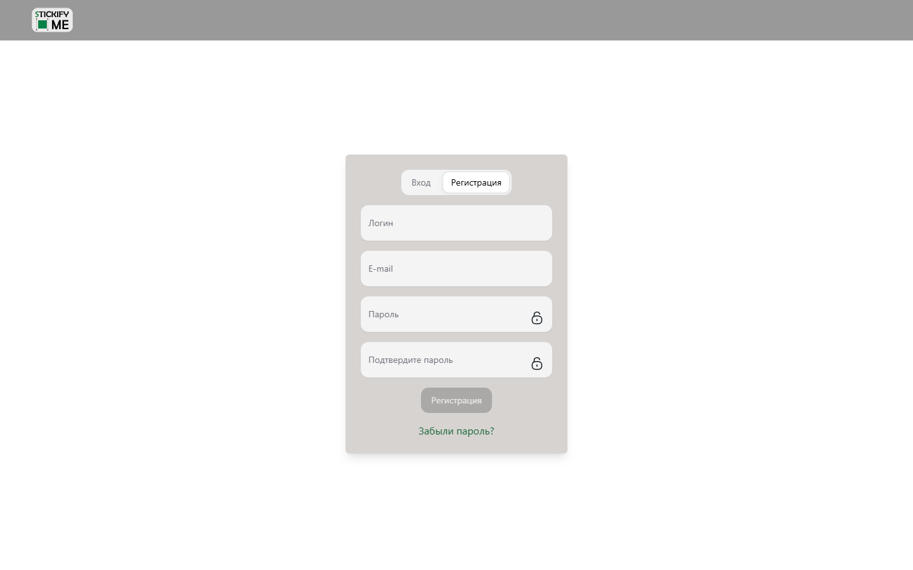
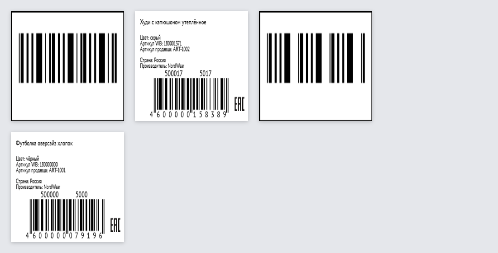
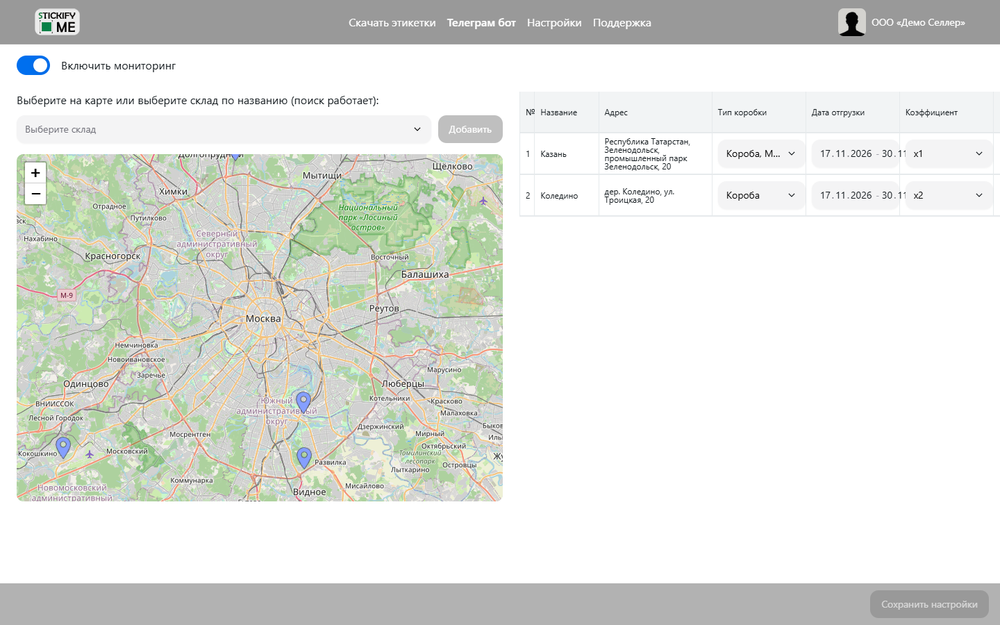
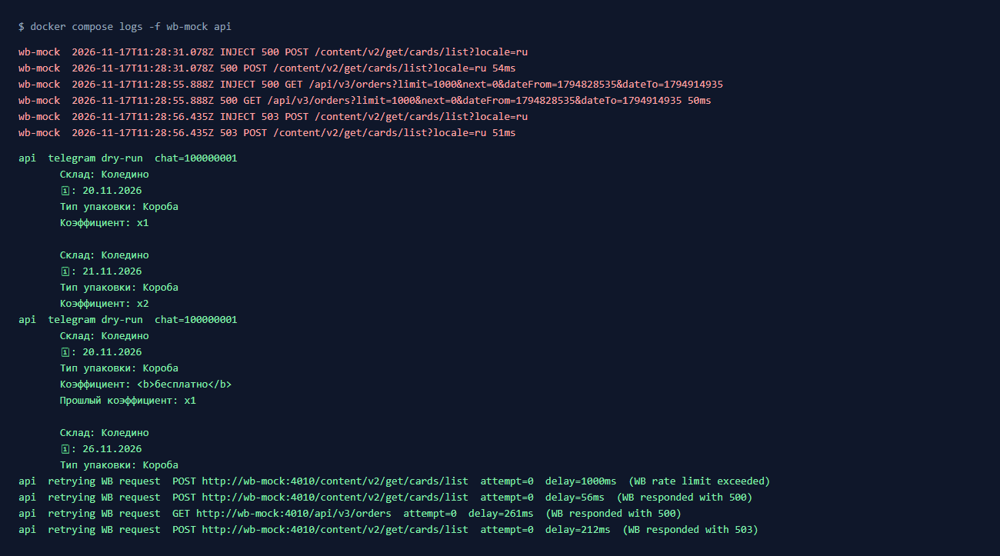

# StickifyMe

Сервис для продавцов Wildberries (FBS): печать логистических этикеток для заказов и мониторинг
коэффициентов приёмки складов с уведомлениями в Telegram.

> **Статус:** проект закрыт в октябре 2026, код опубликован как портфолио.
> Production-окружение и домен больше не работают. Локально всё запускается одной командой,
> реальный API Wildberries заменён моком.



## Какую проблему решал

- **Этикетки.** Для каждого FBS-заказа продавцу нужно напечатать стикер WB и этикетку товара
  (EAN-13, название, артикулы, цвет, страна, знак EAC). В кабинете WB это делается вручную по одному
  заказу. StickifyMe забирает заказы «в сборке» через API, подтягивает стикеры и карточки товаров
  и собирает PDF для термопринтера (58×40) или листа A4 (сетка 3×6).
- **Коэффициенты приёмки.** Бесплатная приёмка на нужном складе появляется на минуты. Сервис
  опрашивает API WB по настройкам продавца (склады, тип коробов, даты, максимальный коэффициент)
  и присылает в Telegram только новые или изменившиеся слоты.

## Быстрый старт

Нужен Docker с Compose v2.

```bash
docker compose up --build
```

Откройте <http://localhost:3000> и войдите как `demo` / `demo12345`. Демо-аккаунт создаёт сервис `seed`:
ключ WB (принимается моком), настройки мониторинга двух складов, история этикеток.

| Сервис | Адрес | Что это |
|---|---|---|
| web | <http://localhost:3000> | Next.js (Pages Router) |
| api | <http://localhost:4000> | Express + TypeScript |
| wb-mock | <http://localhost:4010> | мок API Wildberries |
| mongo | только внутри сети compose | MongoDB 7 |

Если порты заняты: `WEB_PORT=3300 API_PORT=4400 docker compose up --build`.
Все настройки описаны в [.env.example](.env.example); без `.env` всё работает со значениями по умолчанию.

<details>
<summary>Разработка без Docker</summary>

```bash
cp .env.example .env            # JWT_SECRET, MONGO_URI (нужен свой MongoDB)
cd wb-mock && yarn start        # или: node src/server.ts (Node 22.18+)
cd server && yarn && yarn seed:dev && yarn dev
yarn && yarn dev                # web на :3000
```

Проверки: `yarn lint && yarn typecheck` в корне; `yarn lint && yarn typecheck && yarn test` в `server/`.
</details>

## Архитектура



Слои на бэкенде: **routes → тонкие controllers → services → repositories**. Все зависимости
(репозитории, `WbClient`, `Mailer`, `TelegramBot`, `WarehouseMonitor`, `SecretBox`) создаются в одном
месте, в composition root [`server/src/index.ts`](server/src/index.ts), и передаются явно.
Синглтонов на уровне модулей нет, поэтому сервисы тестируются с фейками без моков модулей.

```
server/src
├── index.ts              composition root: создаёт и связывает зависимости, graceful shutdown
├── app.ts                только HTTP-слой: middleware и роутеры
├── config/               env → типизированный конфиг (zod), падает на старте при ошибке
├── http/                 routes, controllers, schemas (zod), middlewares (auth, validate, errors)
├── services/             бизнес-логика: auth, import, labels/labelPdf, monitoring, ...
├── integrations/wb/      клиент Wildberries: http (retry), schemas (zod), errors
├── repositories/         доступ к MongoDB (Mongoose 8)
├── telegram/             бот: привязка чата и отправка уведомлений
└── mail/                 Mailer и шаблоны писем с экранированием
```

## Ключевые технические решения

### Отказоустойчивая интеграция с нестабильным API

API Wildberries регулярно отвечает 429 и 5xx и иногда зависает. Клиент
[`integrations/wb`](server/src/integrations/wb) сделан с расчётом на это:

- **таймаут на каждую попытку** (`AbortSignal.timeout`): зависший запрос не держит импорт;
- **retry с exponential backoff и full jitter** для 429, 5xx, сетевых ошибок и таймаутов. Jitter
  разносит повторы во времени, чтобы клиенты не били в API синхронно;
- **429 с учётом `Retry-After`** (секунды или HTTP-дата). Если сервер просит ждать дольше лимита,
  клиент сразу возвращает ошибку, а не блокирует запрос пользователя;
- **401/403 и прочие 4xx не повторяются**: ключ неверен, повтор не поможет;
- **zod-валидация каждого ответа.** Нарушение контракта превращается в `WbBadResponseError` с
  залогированными деталями, а не в `TypeError` глубоко в коде;
- **доменные ошибки** (`WbAuthError`, `WbRateLimitError`, `WbUnavailableError`, ...) в одном месте
  переводятся в HTTP-ответы с понятным текстом (`toHttpError`).

`fetch`, `sleep` и `random` внедряются, поэтому повторы покрыты детерминированными тестами без
реального ожидания ([`wb-http.test.ts`](server/tests/wb-http.test.ts)). В локальном стенде мок
по умолчанию отдаёт часть ответов 429/5xx, и повторы видны в логах API (`retrying WB request`).

### Событийный мониторинг коэффициентов

- Для каждого продавца с включённым мониторингом и привязанным чатом работает `WarehouseChecker`,
  который опрашивает WB по интервалу. Медленный ответ не приводит к наложению проверок.
- Сравнение свежих данных с последним снимком — чистая функция `diffCoefficients`. Уведомление
  уходит только о новых или изменившихся слотах, подходящих под настройки (склад, тип коробов,
  даты, порог коэффициента). Снимок хранится в MongoDB и переживает рестарт.
- Если WB отклоняет ключ (401), мониторинг останавливается и продавец получает одно сообщение,
  а не бесконечную серию ошибок. После смены ключа или привязки чата мониторинг стартует сразу.
- Telegram получает HTML с экранированными данными WB; длинные списки режутся по лимиту 4096 символов.
- Чат привязывается через одноразовый токен в deep link (`t.me/<bot>?start=<token>`). В базе хранится
  только хэш токена, расход атомарный (`findOneAndUpdate`).

### Печать этикеток

- Импорт заказов идёт на сервере: заказы «в сборке» → стикеры WB батчами с паузой (лимиты WB) →
  карточки товаров. Прогресс передаётся в браузер потоком NDJSON (`fetch` + `ReadableStream`),
  без polling'а и WebSocket.
- PDF строится в памяти на pdfkit ([`labelPdf.ts`](server/src/services/labels/labelPdf.ts)):
  термопринтер 58×40 или сетка A4; штрихкод EAN-13 рисует JsBarcode как SVG.
- Заказ без стикера пропускается: подставлять чужие номера на этикетку нельзя.

### Безопасность

- WB-ключ продавца хранится зашифрованным (AES-256-GCM, версионированный формат), проверяется
  на сервере и никогда не уходит в браузер.
- zod-валидация всех входных данных (защита от NoSQL operator injection и mass assignment);
  централизованная обработка ошибок; rate limit на вход и сброс пароля; одинаковый ответ на
  «нет пользователя» и «неверный пароль»; bcrypt cost 12; сброс пароля без перечисления аккаунтов;
  хэшированные одноразовые токены; проверка загружаемых аватаров по сигнатуре файла.
- Структурированные JSON-логи (pino) с редактированием токенов и паролей.

Подробно о том, что и зачем изменено перед публикацией: [docs/REFACTORING.md](docs/REFACTORING.md).

### CI/CD и качество

- GitHub Actions ([ci.yml](.github/workflows/ci.yml)): lint, typecheck и тесты фронта и API,
  сборка Docker-образов.
- ~100 тестов на Vitest: supertest против настоящего Express-приложения, MongoDB в памяти
  (mongodb-memory-server), фейки WB API для retry, 429, невалидных ответов и мониторинга.
- Multi-stage Docker-образы на Node 22, процессы под non-root пользователем, MongoDB не опубликована наружу.
- Состояние зависимостей и разбор оставшихся advisories: [docs/dependency-audit.md](docs/dependency-audit.md).

## Мок Wildberries API

[`wb-mock/`](wb-mock) — сервер на Node 22 без зависимостей. Он отдаёт фикстуры заказов, стикеров (PNG),
карточек, складов и коэффициентов; коэффициенты меняются раз в минуту, чтобы мониторингу было что
сообщать. Любой ключ, кроме начинающихся с `invalid`, считается действительным.

| Как управлять | Пример |
|---|---|
| Доля сбоев при старте | `WB_MOCK_FAILURE_RATE=0.3 WB_MOCK_FAILURE_MODES=429,500,timeout docker compose up` |
| Сбои на лету | `curl -X POST localhost:4010/__mock/failures -d '{"rate":0.5,"modes":["429"]}'` |
| Сбой одного запроса | заголовок `x-mock-fail: 429` (или `500`, `503`, `timeout`) |
| Статистика | `curl localhost:4010/__mock/stats` |

Логи мока и повторы клиента: `docker compose logs -f wb-mock api`.

## Telegram и почта без токенов

- Без `TELEGRAM_BOT_TOKEN` бот не запускается, а уведомления мониторинга пишутся в лог API
  (`telegram dry-run`). Демо-профилю привязан фиктивный чат, поэтому уведомления появляются
  в логах примерно через минуту после старта.
- Чтобы получать сообщения в Telegram, создайте бота у @BotFather и укажите `TELEGRAM_BOT_TOKEN` и
  `NEXT_PUBLIC_TELEGRAM_BOT_NAME`, затем нажмите «Подключить Telegram бота» в кабинете.
- Без `SMTP_HOST` письма (сброс пароля и т. п.) не отправляются, а пишутся в лог.

## Скриншоты

Разметка под скриншоты лежит в [docs/screenshots](docs/screenshots/README.md).

| | |
|---|---|
|  |  |
|  |  |
|  |  |

## Стек

Next.js 14 (Pages Router), React 18, MobX, NextUI, Tailwind · Node.js 22, Express 4, TypeScript (strict),
Mongoose 8 / MongoDB 7, zod, pino, pdfkit, JsBarcode, node-telegram-bot-api · Vitest, supertest,
mongodb-memory-server · Docker Compose, GitHub Actions.
